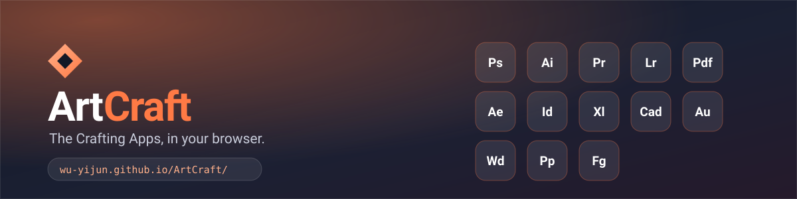

# ArtCraft — free creative apps online

ArtCraft is a collection of open-source creative tools that run directly in your browser. It is a
simple place to find free online alternatives to **Photoshop, Illustrator, Lightroom, Premiere,
After Effects, Figma, AutoCAD, Excel, PowerPoint, Word and Acrobat**.

**[Open ArtCraft online](https://Wu-Yijun.github.io/ArtCraft/)**



## What can I use it for?

Choose an app for image editing, vector illustration, video editing, motion graphics, audio work,
PDFs, page layout, UI prototyping, spreadsheets, CAD drafting, documents or presentations.

| App | Best for | Open online |
| --- | --- | --- |
| **PhotoCraft** | Photoshop-style image editing | [PhotoCraft](https://Wu-Yijun.github.io/ArtCraft/photoshop/) |
| **VectorCraft** | Illustrator-style vector drawing | [VectorCraft](https://Wu-Yijun.github.io/ArtCraft/illustrator/) |
| **LightCraft** | Lightroom-style photo library and RAW development | [LightCraft](https://Wu-Yijun.github.io/ArtCraft/lightroom/) |
| **FilmCraft** | Premiere-style video editing | [FilmCraft](https://Wu-Yijun.github.io/ArtCraft/premiere/) |
| **EffectCraft** | After Effects-style motion graphics and VFX | [EffectCraft](https://Wu-Yijun.github.io/ArtCraft/aftereffects/) |
| **PdfCraft** | Reading, organizing and editing PDFs | [PdfCraft](https://Wu-Yijun.github.io/ArtCraft/pdf/) |
| **DesignCraft** | InDesign-style page layout | [DesignCraft](https://Wu-Yijun.github.io/ArtCraft/indesign/) |
| **FigCraft** | Figma-style UI design and prototyping | [FigCraft](https://Wu-Yijun.github.io/ArtCraft/figma/) |
| **GridCraft** | Excel-style spreadsheets and data analysis | [GridCraft](https://Wu-Yijun.github.io/ArtCraft/excel/) |
| **CADCraft** | AutoCAD-style drafting and CAD | [CADCraft](https://Wu-Yijun.github.io/ArtCraft/autocad/) |
| **SoundCraft** | Audition-style audio recording and mixing | [SoundCraft](https://Wu-Yijun.github.io/ArtCraft/audition/) |
| **WordCraft** | Word-style document editing | [WordCraft](https://Wu-Yijun.github.io/ArtCraft/word/) |
| **DeckCraft** | PowerPoint-style presentations | [DeckCraft](https://Wu-Yijun.github.io/ArtCraft/powerpoint/) |

## Why ArtCraft?

- **Runs in the browser:** no desktop installation or account is required to try an app.
- **Private by design:** the web apps run locally in your browser; ArtCraft does not upload your
  working files from this directory.
- **Open source:** each app is built from scratch in Rust and compiled to WebAssembly.
- **Easy links:** familiar aliases such as `/ps/`, `/photo/`, `/ai/`, `/pdf/` and `/ppt/` redirect
  to the corresponding app.

## How this repository works

The app source repositories live under [github.com/storytold](https://github.com/storytold). This
repository is the release collector and static publisher. The pipeline checks the latest GitHub
release, downloads the web bundle only when it changed, caches it, and publishes the result to
GitHub Pages.

```text
config.yaml → GitHub releases → cache → deploy/ → GitHub Pages
```

`deploy/index.html` is the human-facing directory. `deploy/apps.json` and the app folders are
generated by `node src/main.ts`; they should not be edited by hand.

## Run locally

Node 24 or newer is required:

```sh
pnpm install
node src/main.ts
```

To increase the GitHub API rate limit, create a `.env` file next to `config.yaml`:

```sh
GITHUB_TOKEN=github_pat_...
```

Useful commands:

```sh
pnpm typecheck
node src/main.ts > logs/run.log 2>&1
```

## Add or change an app

Edit the `apps` list in [`config.yaml`](config.yaml). Each app needs a display name, a public path,
its source repository, a release filename pattern, a description and an entry filename. Add short
lowercase aliases for search-friendly paths, then run the pipeline. The publisher also injects the
app favicon, canonical URL, Open Graph card and Twitter card into every configured app entry.

## Project layout

| Path | Purpose |
| --- | --- |
| `src/` | Release and deployment pipeline |
| `config.yaml` | Website and app configuration |
| `deploy/index.html` | Static ArtCraft app directory |
| `static/hero.svg` | README banner |
| `static/icons/` | Software icons used by app cards and metadata |
| `artcraft-apps/` | Local cache and downloaded releases; not committed |

## Trademarks and license

Photoshop, Illustrator, Lightroom, Premiere, After Effects, Figma, AutoCAD, Excel, PowerPoint,
Word, Acrobat and other product names are trademarks of their respective owners. ArtCraft is an
independent clean-room project and is not affiliated with or endorsed by those companies.

The deployment code in this repository is released under the [MIT License](LICENSE). Each app keeps
its own license files and distribution terms.
